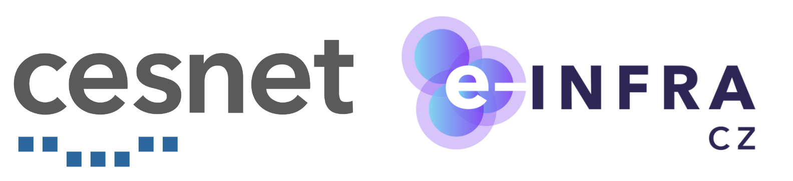
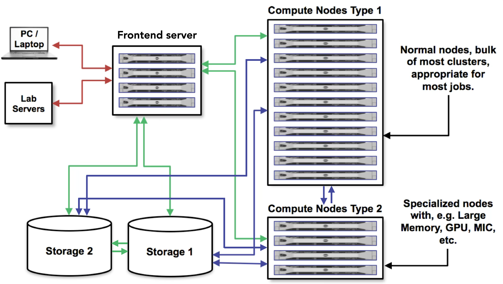
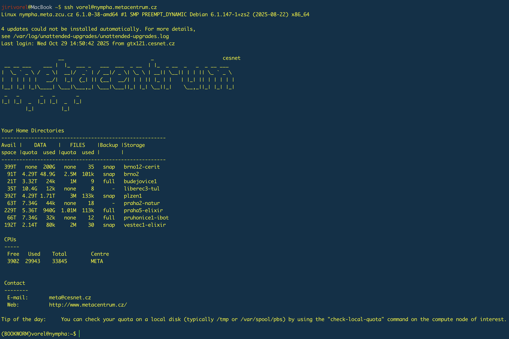
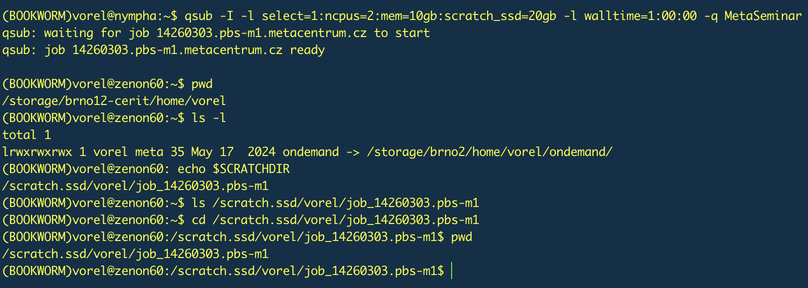

# **Hands-on course, The Faculty of Informatics, Masaryk University Brno, November 2026**

Jiří Vorel (vorel@cesnet.cz) created this readme.

Jiří Vorel taught the course.

The information given in the course is current as of 4 November 2026.

<p align="center"></p>

# Table of contents
* [Introduction](#introduction)
 	* [Aims](#aims)
	* [Prerequisites](#prerequisites)
	* [Dedicated resources](#dedicated-resources)
	* [Data and tools](#data-and-tools)
	* [Useful links](#useful-links)
* [Log in to the frontend server](#log-in-to-the-frontend-server)
* [Basic orientation in your home directory](#basic-orientation-in-your-home-directory)
* [System of software modules](#system-of-software-modules)
* [Obtain the data](#obtain-the-data)
* [Inspect the POD5 files](#inspect-the-pod5-files)
* [Basecalling](#basecalling)
* [Quality control](#quality-control)
* [Extract modified bases](#extract-modified-bases)

# Introduction

## Aims
This tutorial takes the form of a brief hands-on course showing how to process and analyse sequencing data using the [MetaCentrum NGI](https://www.metacentrum.cz/en/index.html) (National Grid Infrastructure). Participants will be introduced to the fundamentals of using MetaCentrum, including how to [log in to the frontend server](https://docs.metacentrum.cz/en/docs/access/log-in), [manipulate data](https://docs.metacentrum.cz/en/docs/data/large-data), [start an interactive or batch job](https://docs.metacentrum.cz/en/docs/computing/run-basic-job) and [install applications](https://docs.metacentrum.cz/en/docs/software/install-software) locally.

During the practical session, we will analyse private (unpublished) [Oxford Nanopore Technologies](https://nanoporetech.com/) (ONT) data from a pilot project investigating the distribution of methylation sites in the genome of [_Haemonchus contortus_](https://en.wikipedia.org/wiki/Haemonchus_contortus), a gastrointestinal parasite of small ruminants. Unfortunately, processing raw ONT reads, basecalling, and working with modified bases often require considerable hardware resources and time-consuming tuning to find the optimal parameters. To speed up the course, we will use a reduced input dataset and mostly default parameters during data processing.

<p align="center"></p>

> [!IMPORTANT]  
> **The aim of this course is not to create a perfect ONT data processing pipeline.**
> 
> Due to the time limitations of this course and its primary focus on using the grid infrastructure as effectively as possible, we will perform a few basic steps on a small sample of ONT genomic reads. Our goal is to identify modified (methylated) bases.

> [!NOTE]
> Throughout this tutorial, important points are supplemented with links to more detailed descriptions and explanations in the [documentation](https://docs.metacentrum.cz/en/docs/welcome).

## Prerequisites

To get the most out of this course, each participant should
  -  **be a registered MetaCentrum user** (due to the account approval and creation process, applications must be submitted no later than one day before the start of the course).
  -  **know the login information** (username and password, created during the application process).
  -  **have a laptop/PC with a working internet connection.**
  -  **be able to log in to the remote server via the SSH protocol.**
  -  **know how to use the command line interface (CLI)**, recommended.
  
> [!NOTE]
> This course is designed for participants with no prior experience of using the command line. However, some basic knowledge is recommended. All commands and shell scripts used during the course can be found below and copied directly.

> [!NOTE]
> Participants do not need to download or install any data or software tools before the course. Data will be downloaded during the course, and all software tools (which are freely available for non-commercial use) are already accessible to MetaCentrum users. If not, we will install them.

## Dedicated resources

As is typical for grid computing, submitted jobs are sorted into specific [queues](https://docs.metacentrum.cz/en/docs/computing/resources/queues), mainly based on the amount of requested resources. The delay between job submission and the start of the calculation is determined by the combination of the required resources and the current infrastructure load. Very demanding jobs may have to wait several days in the queue before all the required resources are free. To avoid this, we will use a special queue reserved exclusively for this course, `MetaSeminar`. This queue uses the [aman10.metacentrum.cz](https://my.metacentrum.cz/machines/aman10.metacentrum.cz) compute node with 56 Intel Xeon E7-4830 CPU cores (4x14), 512 GB RAM and a 7 TB HDD scratch disk. 

> [!IMPORTANT]  
> Each job submitted during this course must target this dedicated queue. As you will see later, interactive jobs will include the parameter `-q MetaSeminar`, while batch jobs will include the line `#PBS -q MetaSeminar`. The job scheduler PBSPro will send jobs to this specified queue in both cases.

## Data and tools

The following data and software tools will be used during the course:

 - Oxford Nanopore reads (will be provided during the course).
 - [POD5](https://github.com/nanoporetech/pod5-file-format) python package for inspecting and manipulating POD5 files.
 - [Dorado](https://github.com/nanoporetech/dorado) for basecalling.
 - [Cramino](https://github.com/wdecoster/cramino) for quick quality assessment.
 - [Samtools](https://github.com/samtools/samtools) for handling BAM files.
 - [Modkit](https://github.com/nanoporetech/modkit) for working with modified bases from Oxford Nanopore.

## Useful links
 - [MetaCentrum terms and conditions](https://docs.metacentrum.cz/en/docs/access/terms)

> [!NOTE]
> Access to MetaCentrum is free of charge for members (employees and students) of academic and research institutions in the Czech Republic.
   
 - [Documentation](https://docs.metacentrum.cz/)
 - [MetaCentrum webinars](https://github.com/CESNET/metacentrum-webinars)
 - [Past seminars](https://metavo.metacentrum.cz/cs/seminars/)
 - [Monitoring page](https://my.metacentrum.cz/personal-view)
 - [Contact for user support](https://docs.metacentrum.cz/en/docs/support)
 - [MetaCentrum Cloud - a computing cloud built using OpenStack](https://cloud2.metacentrum.cz/)
 - [Kubernetes container platform](https://docs.cerit.io/en/docs/news)
 - [AI and LLMs](https://docs.cerit.io/en/docs/ai-as-a-service/introduction)
 - [Galaxy](https://usegalaxy.cz/)
 - [e-INFRA CZ blog](https://blog.cerit.io/)
 - [MetaCentrum ambassadors](https://metavo.metacentrum.cz/cs/ambasadors/ambasadors-list.html)
 - MetaCentrum is an activity of the [CESNET](https://www.cesnet.cz/?lang=en) association, which is part of the [e-INFRA CZ](https://www.e-infra.cz/en), a unique research and development e-infrastructure in the Czech Republic that provides the capacity to transmit, store and process scientific and research data.

<p align="center"></p>

# Log in to the frontend server

Like most computing and data centres, MetaCentrum's compute nodes run exclusively on Linux (OS [Debian](https://www.debian.org/)) and are primarily controlled via the command line. Linux is favoured for its stability, security, speed, adaptability and compatibility. Furthermore, advanced scientific software tools are primarily designed and optimised for Linux.

> [!IMPORTANT]  
> MetaCentrum does not offer the OS Windows and its applications.

We will use one of the login servers, known as the [frontend](https://docs.metacentrum.cz/en/docs/computing/infrastructure/frontend-storage), to log in. [These servers](https://docs.metacentrum.cz/en/docs/computing/infrastructure/frontends) are accessible via the SSH protocol and act as the main gateway for the entire infrastructure.

> [!WARNING]
> Frontend servers are virtual machines with very limited computational power. They are primarily used for basic data inspection and manipulation, preparing shell scripts for batch jobs and short compilations. Do not use them for long or demanding calculations :pray:; use an [interactive job](https://docs.metacentrum.cz/en/docs/computing/run-basic-job#5-b-run-as-an-interactive-job) instead.

> [!IMPORTANT]
> Long and demanding calculations running directly on frontend servers are terminated automatically.

> [!NOTE]
> MetaCentrum can be accessed worldwide. We do not implement any geoblocking.

The following diagram illustrates the position of the frontend servers (labelled as **Login nodes**) within the grid infrastructure. [This page](https://docs.metacentrum.cz/en/docs/computing/infrastructure/frontends) lists all accessible frontend servers.

<p align="center"></p>

In the following tutorial, we will use the `nympha` frontend with the address `nympha.metacentrum.cz` to log in. Nympha runs on Debian 12, and the home directory is mounted on the `plzen1` storage (accessible as `/storage/plzen1/home/$USER/`). However, any other standard frontend server can also be used. They all have the same functionality.

> [!NOTE]  
> The system variable USER (`$USER`) is set automatically after logging in and contains the real username.

> [!IMPORTANT]  
> MetaCentrum does not fully support traditional SSH key authentication for logging in. 
> MetaCentrum uses the [Kerberos](https://docs.metacentrum.cz/en/docs/access/log-in#kerberos) system for authentication, which requires a **username** and **password**.

> [!TIP]
> Kerberos is available for all operating systems and can be [installed and configured](https://docs.metacentrum.cz/en/docs/access/security/kerberos#install-kerberos) on your personal computer. This enables you to generate a local Kerberos ticket with a lifetime of up to 24 hours, allowing you to log in to MetaCentrum nodes without entering your password for this period.

Windows OS users can use an SSH client such as PuTTY ([as described here](https://docs.metacentrum.cz/en/docs/software/graphical-access#connect-with-putty-in-windows)). Newer versions of OS Windows have a built-in OpenSSH client. Command-line interface (CLI) users can open their terminal and type the following command, replacing `user_name` with their actual MetaCentrum username and then enter their password.

```shell
ssh user_name@nympha.metacentrum.cz
# Replace `user_name` with your exact MetaCentrum username.
```

> [!NOTE]
> No characters will appear when typing a password into the terminal. This is standard security behaviour.

> [!IMPORTANT]  
> **Never share your MetaCentrum password with anyone else.** This could be seen as a breach of the terms of use, which could result in your account being banned.

Now, let's try to log in to the Nympha frontend server...

You have successfully logged in when you see the overview of your quotas on the individual [storage servers](https://docs.metacentrum.cz/en/docs/include/storages). Expand the following section for comparison. The colour scheme varies depending on personal terminal settings.

<details>
<summary>Expand this section to see what a successful login looks like.</summary>
<p align="center"></p>
</details>

# Basic orientation in your home directory

In MetaCentrum, the graphical interface found on desktop computers is usually lacking. Instead, we use text commands. The following table shows a few commands for basic work with the Linux command line. We will use most of these commands further on in the course.

> [!TIP]
> There are hundreds of other commands. You can find more comprehensive tutorials on this topic online, such as this [one](https://www.freecodecamp.org/news/the-linux-commands-handbook/).

| Command | Action |
| ------------- | -------------|
| `.` or `./`  | Refers to the present location. |
| `..` or `../` | Refers to the parent directory. |
| `cat` | Prints the entire content of a file. |
| `cd` | Changes the working directory. |
| `cp` | Copies files. |
| `cp -r` | Copies files and directories with their contents. |
| `export` | Updates the current shell session. |
| `head` | Prints the first ten lines of a file. |
| `less` | Prints a file's contents one screen at a time. |
| `ls` | Lists a directory's contents. |
| `ls -lh` | Lists a directory's contents in a columnar, human-readable format. |
| `mkdir` | Creates a new directory. |
| `mkdir -p` | Creates a new directory and any necessary parent directories. |
| `nano` | Opens a lightweight text editor. |
| `mv` | Moves or renames files and directories. |
| `pwd` | Prints the path of the current working directory. |
| `rm` | Removes a file. |
| `rmdir` | Removes an empty directory. |
| `rm -r` | Removes the directory and its content. |
| `rsync` | Transfers and synchronises files. |
| `scp` | Transfers data. |
| `ssh` | Provides a secure, encrypted connection between two hosts over an insecure network. |
| `time` | Determines how long a given command takes to finish. |
| `touch` | Creates an empty file. |

> [!TIP]
> The CLI is not the only way to use MetaCentrum and related services. Also, GUI access and applications are available. For example, the [Open OnDemand](https://docs.metacentrum.cz/en/docs/graphical/ondemand) service, [virtual network computing](https://docs.metacentrum.cz/en/docs/software/graphical-access), [Galaxy](https://usegalaxy.cz/) or the [Rancher/Kubernetes](https://docs.cerit.io/) platform.

Once you have successfully logged in via the command

```shell
ssh user_name@nympha.metacentrum.cz
# Replace `user_name` with your exact MetaCentrum username.
```

you will then be taken to your home directory by default. You can use the `pwd` command to display the absolute path to your current location in the system (working directory).

```shell
pwd
```

The files and directories you can see, access and use depend on your current location, i.e. where you are in the system. Use the `ls` command to see what files and directories are available at your current location, i.e. in your home directory.

```shell
ls
```

We can create a new directory named `test_directory`. If you do not like this name, you can choose a different one :wink:.

```shell
mkdir test_directory
```

Once the `test_directory` folder has been created, run these two commands and compare what was printed in the terminal.

```shell
ls
```
```shell
ls -l
```

> [!NOTE]  
> The terms **folder** and **directory** are interchangeable.

We will also need to edit text files, specifically the shell scripts for the batch jobs. We can use the `touch` command to create an empty file. Let's call this file `test_file.txt`.

```shell
touch test_file.txt
```

You can then run the `ls` or `ls -lh` command again (depending on your preference) to check whether the file `test_file.txt` was created successfully.

<details>
<summary>Expand this section and compare the results with me.</summary>
 
```shell
(BOOKWORM)vorel@nympha:~$ ls
test_directory	test_file.txt
(BOOKWORM)vorel@nympha:~$ ls -lh
total 1.0K
drwxr-xr-x 2 vorel meta 4.0K Oct 30 14:15 test_directory
-rw-r--r-- 1 vorel meta    0 Oct 30 14:15 test_file.txt
```
</details>

Let's use the text editor [nano](https://www.nano-editor.org/) to open and edit the text file `test_file.txt`. 

```shell
nano test_file.txt
```

> [!TIP]
> Use the `tab` key to autocomplete file or folder names. 

> [!NOTE]  
> MetaCentrum also offers other editors, such as `vi`, `vim` and `mcedit`. 

You can start typing text as soon as the `nano` editor is open. When you have finished, press the keys `ctrl` and `x` simultaneously. You will then be asked if you want to save the changes (`Save modified buffer?`). Press `y`, then press the `enter` key to overwrite the original file `test_file.txt`.

To print the contents of the text file in the terminal, use the `cat` command.

```shell
cat test_file.txt
```

> [!WARNING]
> The `cat` command prints the entire contents of a file to the terminal all at once. Therefore, it is not suitable for viewing very long text files. A better option is the `less` command, which displays a file's contents one screen at a time.

Finally, we can try to rename the file `test_file.txt` to `test_file_renamed.txt` and move it into the directory `test_directory`.

> [!NOTE]  
> Remember that the `mv` command can rename and move files and folders.

```shell
mv test_file.txt test_file_renamed.txt
```
```shell
mv test_file_renamed.txt test_directory
```

In the final step of this chapter, we can check whether the renamed file `test_file_renamed.txt` has been moved to the correct location. If so, we can delete the `test_directory` folder and its contents, as we will have no further use for them. 

```shell
ls test_directory
```
```shell
rm -r test_directory
```

# System of software modules 

The software tools available in MetaCentrum are accessible via [environment modules](https://modules.readthedocs.io/en/stable/index.html#). This system simplifies the precise and controlled use of different software. Each program (and each version, potentially with additional modifications) is prepared as an individual module that must be activated (loaded) before use. This modifies the user's environment, setting everything necessary for the program to run, especially the `$PATH` and `$LD_LIBRARY_PATH` variables and dependencies.

> [!TIP]
> How to work with MetaCentrum modules is described in detail [here](https://docs.metacentrum.cz/en/docs/software/modules).

> [!IMPORTANT]  
> MetaCentrum provides several thousand modules. With such a large number of modules, manual control is no longer possible, and occasionally things do not work perfectly. If you experience any issues, please email us at meta@cesnet.cz.

> [!IMPORTANT]  
> As MetaCentrum provides hundreds of tools, it is not possible to keep all of them up to date. If you require a newer version of a tool or any new tool, please email us at meta@cesnet.cz. However, we encourage users to [install the tools themselves](https://docs.metacentrum.cz/en/docs/software/install-software), and we are available to assist with this process.

We can run a few commands and explain how the module system works. Let's try to load a module for [BLAST+](https://blast.ncbi.nlm.nih.gov/doc/blast-help/downloadblastdata.html#downloadblastdata).

```shell
module ava blast
```
```shell
module ava *blast*
```
```shell
module ava blast-plus/
```
```shell
module add blast-plus/2.16.0-gcc
```
```shell
module list
```
```shell
module rm blast-plus
```
```shell
module list
```
> [!WARNING]  
> Remember that activating a module modifies your environment in some way. Loading too many modules in a single session can lead to conflicts, resulting in some applications not functioning correctly. The module that could conflict with others can only be reliably limited to specific parts of the job.

> [!IMPORTANT]  
> The command `module rm` may not always undo all the changes to the environment.

```shell
( module add module_name_1
programme_1 < in_1 > out_1
)
# After the closing parenthesis, the module is deactivated, and all its modifications of the environment are reverted. Another module can then be safely loaded.
module add module_name_2
programme_2 < in_2 > out_2
```

# Obtain the data

This practical course will begin with the copying of raw sequencing signals (ONT POD5 data) from the _H. contortus_ IRE strain (benzimidazole-resistant), obtained from a private DNA sequencing project.

The methodology will include the following steps:
- creating a new directory for the raw data.
- copying the data using different methods (`cp`, `scp` and `rsync`).

If you are not already logged in, let's start by logging in to the `nympha` frontend server.

```shell
ssh user_name@nympha.metacentrum.cz
# Replace `user_name` with your exact MetaCentrum username.
```

If you are not in your home directory (`/storage/plzen1/home/$USER/`), you can navigate there by typing the `cd` command with no parameters. You can use the `pwd` command to check your current working directory.

```shell
pwd
```

```shell
cd
```

We can now create an empty folder to store the raw ONT data, which consists of a few POD5 files totalling approximately 2.5 GB. We will then process these files further. We can name this folder `raw_signal`, but you can choose a different name. The folder `raw_signal` will be a subfolder of `fi_muni_course`. 

```shell
mkdir -p fi_muni_course/raw_signal
```

Firstly, though, take a look at what you will be copying.

```shell
ls -lh /storage/brno2/home/vorel/META_SUPPORT/Hands_on/04_FI_MUNI
```

There are three different methods we can use to copy these files. The most common commands are `cp`, `scp` and `rsync`.

> [!TIP]
> The effective transfer of large volumes of data in MetaCentrum is described in detail [here](https://docs.metacentrum.cz/en/docs/data/large-data).

```shell
cp /storage/brno2/home/vorel/META_SUPPORT/Hands_on/04_FI_MUNI/*pod5 fi_muni_course/raw_signal
```

```shell
scp storage-brno2.metacentrum.cz:../vorel/META_SUPPORT/Hands_on/04_FI_MUNI/*pod5 fi_muni_course/raw_signal
```

```shell
rsync -avhP storage-brno2.metacentrum.cz:../vorel/META_SUPPORT/Hands_on/04_FI_MUNI/*pod5 fi_muni_course/raw_signal
```

| Flag | Meaning |
| ------------- | -------------|
| `-a` | Preserves permissions, timestamps and symbolic links and copies directories recursively. |
| `-v` | Displays detailed output during transfer. |
| `-h` | Output numbers in a human-readable format. |
| `-P` | Displays a progress bar and allows interrupted transfers to be resumed. |

> [!IMPORTANT]
> The traditional `cp` command is not optimal for transferring large datasets, whether run through the frontend server or in batch jobs.

> [!NOTE]  
> The speed at which data is copied depends on the total storage load and the distance between the source and destination. This speed may also vary over time.

# Inspect the POD5 files

The [POD5 file format](https://software-docs.nanoporetech.com/pod5/latest/), which is based on [Apache Arrow](https://arrow.apache.org/), is a file format for storing nanopore sequencing data in an easily accessible way. POD5 significantly improves read/write speeds and reduces file size while enabling efficient parallel access. It is faster and more storage-efficient than the older FAST5 file format and is fully supported by the latest ONT tools, such as [Dorado](https://software-docs.nanoporetech.com/dorado/latest/).

In this part of the course, we will install the POD5 python package and examine the POD5 data.

The methodology will include the following steps:
- starting an [interactive job](https://docs.metacentrum.cz/en/docs/computing/run-basic-job#interactive-job) with [scratch storage](https://docs.metacentrum.cz/en/docs/computing/infrastructure/scratch-storages).
- installing the POD5 python package.
- viewing a summary of POD5 files.

> [!IMPORTANT]  
> We encourage users to [install the tools themselves](https://docs.metacentrum.cz/en/docs/software/install-software), and we are available to assist with this process.

Firstly, we will submit the [interactive job](https://docs.metacentrum.cz/en/docs/computing/run-basic-job#interactive-job). The meaning of the individual parts of the command is explained below.

```shell
qsub -I -l select=1:ncpus=2:mem=10gb:scratch_local=20gb -l walltime=1:00:00 -q MetaSeminar
```

| Parameter | Action |
| ------------- | -------------|
| `qsub` | Command that submits jobs. |
| `-I` | Declares that the job is to be run interactively. |
| `select=1` | Reserves resources on one physical node. |
| `ncpus=2` | Reserves two processors (threads). |
| `mem=10gb` | Reserves 10 GB of RAM. |
| `scratch_local=20gb` | Reserves 20 GB of disk space on scratch. |
| `walltime=1:00:00` | Reserves one hour for the job. |
| `-q MetaSeminar` | Submits the job to the MetaSeminar queue. |

> [!TIP]
> The qsub command, with its most essential parameters, can be [assembled online](https://my.metacentrum.cz/qsub-assembler).

<details>
<summary>Expand this section to see what submitting an interactive job looks like. By the way, are you still in the same home directory as on the nympha front end? Where is the scratch directory that we reserved in the qsub command? </summary>
<p align="center"></p>
</details>

> [!IMPORTANT]  
> Scratch storage is used for temporary files and processed data from running jobs. It should only be used during computations and freed immediately after your job ends. The location of the scratch directory is defined by the system variable `$SCRATCHDIR`.

> [!IMPORTANT]  
> The SCRATCHDIR variable (`$SCRATCHDIR`) is automatically set for each job. Always use `$SCRATCHDIR`. The real path to the scratch directory is unknown before the start of the job because it contains an assigned job number. For example, `/scratch/user_name/job_123456789.pbs-m1/`.

> [!WARNING]  
> **Scratch directories are not backed up!** Once data has been deleted, it cannot be restored.

> [!IMPORTANT]  
> Bear in mind that, by default, different frontend servers and compute nodes may be mounted on different home directories. This is due to the geographical distribution of MetaCentrum resources. However, all disk arrays can be accessed from any compute node or frontend server.

Next, we will install the POD5 python package using the [pip](https://pip.pypa.io/en/stable/) package manager. You can find a general manual on how to install python libraries in MetaCentrum [here](https://docs.metacentrum.cz/en/docs/software/install-software#python-packages). This involves the following steps:

```shell
export TMPDIR=$SCRATCHDIR
# Specify where the temporary files should be stored. Otherwise, you may exceed your quota for the /tmp/ directory.
```

```shell
module add python/3.11.11-gcc
# Load a module for both python and pip.
```

```shell
python --version
# Check the python version.
```

```shell
which pip3
# Check whether pip is being used from an activated python module.
```

```shell
mkdir /storage/plzen1/home/$USER/fi_muni_course/pip_libs
# Create a new folder for libraries installed with pip.
```

```shell
export PYTHONUSERBASE=/storage/plzen1/home/$USER/fi_muni_course/pip_libs
# Set the environment variable PYTHONUSERBASE to a custom directory where python packages will be located.
```

```shell
pip3 install pod5 --user
# Install the POD5 package (along with all its dependencies) into the directory specified by $PYTHONUSERBASE.
```

```shell
export PATH=/storage/plzen1/home/$USER/fi_muni_course/pip_libs/bin/:$PATH
```

```shell
export PYTHONPATH=/storage/plzen1/home/$USER/fi_muni_course/pip_libs/lib/python3.11/site-packages/:$PYTHONPATH
# Set the PATH and PYTHONPATH variables so that POD5 can be run.
```

```shell
pod5 -h
```

```shell
pod5 view -h
# Displays the help message for the POD5 view tool.
```

```shell
pod5 view -t 2 /storage/plzen1/home/$USER/fi_muni_course/raw_signal/*.pod5
# Use POD5 to print a summary to stdout.
```

| Parameter | Action |
| ------------- | -------------|
| `view` | Produce sequencing summary. |
| `-t 2` | Set the number of threads to use. |

```shell
exit
# Terminate the running interactive job.
```

> [!TIP]
> You can terminate running interactive tasks (processes) by pressing the `Ctrl` + `C` keys.

# Basecalling

Basecalling of ONT reads in POD5 format using the [Dorado](https://software-docs.nanoporetech.com/dorado/latest/) basecaller is essential, as the raw signals generated by the nanopore sequencer represent changes in electrical current rather than actual nucleotide sequences. Dorado is ONT’s most recent and accurate basecaller. It uses advanced neural network models to translate the raw signal traces stored in POD5 format into nucleotide sequences with associated quality scores. Basecalling of POD5 ensures faster processing, better compression, and improved data handling compared to the older FAST5 format. This results in greater accuracy, reduced storage requirements and compatibility with ONT’s modern analysis pipelines. Dorado calculations can be significantly sped up on a GPU, for which the software is primarily developed. 

In this part of the course, we will carry out basecalling of ONT reads using a genomic reference. The methodology will include the following steps:
- download the _H. contortus_ reference genome from the [WormBase Parasite](https://parasite.wormbase.org/Haemonchus_contortus_prjeb506/Info/Index/) database.
- download the latest version of the [Dorado basecaller](https://software-docs.nanoporetech.com/dorado/latest/).
- prepare a shell script for a [batch job](https://docs.metacentrum.cz/en/docs/computing/run-basic-job#batch-job-example).

First, download and check the reference genome of _H. contortus_ (BioProject PRJEB506).

```shell
wget -P fi_muni_course https://ftp.ebi.ac.uk/pub/databases/wormbase/parasite/releases/WBPS19/species/haemonchus_contortus/PRJEB506/haemonchus_contortus.PRJEB506.WBPS19.genomic.fa.gz
```

```shell
gunzip fi_muni_course/haemonchus_contortus.PRJEB506.WBPS19.genomic.fa.gz
# Save the genome to the fi_muni_course folder and then extract it.
```

```shell
ls -lh fi_muni_course
# Check the content of the fi_muni_course folder.
```

```shell
head fi_muni_course/haemonchus_contortus.PRJEB506.WBPS19.genomic.fa
# Print the first ten lines of the genomic fasta file to the terminal.
```

> [!TIP]
> It is good practice to compress large volumes of data (into `.zip`, `.gz`, `.tar.gz`, etc.) before transferring them.

We can now [download Dorado](https://software-docs.nanoporetech.com/dorado/latest/#installation). It is available as a pre-built binary file for multiple platforms, so installation is not required. We can simply download and use it. One prerequisite is to have [minimap2](https://github.com/lh3/minimap2) available in `$PATH` for aligning basecalled sequences to a reference.

```shell
curl --output-dir fi_muni_course "https://cdn.oxfordnanoportal.com/software/analysis/dorado-2.1.2-linux-x64.tar.gz" -o dorado-2.1.2-linux-x64.tar.gz
# Save the Dorado archive to the fi_muni_course folder.
```

```shell
tar -xzf fi_muni_course/dorado-2.1.2-linux-x64.tar.gz -C fi_muni_course
# Extract the Dorado archive.
```

```shell
export PATH=/storage/plzen1/home/$USER/fi_muni_course/dorado-2.1.2-linux-x64/bin/:$PATH
```

```shell
export LD_LIBRARY_PATH=/storage/plzen1/home/$USER/fi_muni_course/dorado-2.1.2-linux-x64/lib/:$LD_LIBRARY_PATH
# Set the PATH and LD_LIBRARY_PATH variables so that Dorado can be run.
```

```shell
dorado --version
# Verify the Dorado version.
```

```shell
dorado --help
# Check the available Dorado utilities.
```

```shell
dorado basecaller --help
# Check the help page for the basecaller program.
```

```shell
mkdir fi_muni_course/dorado_models
```

```shell
dorado download --list
```

```shell
dorado download --model dna_r10.4.1_e8.2_400bps_sup@v5.2.0 --models-directory fi_muni_course/dorado_models
# Check the available Dorado models and save one to fi_muni_course/dorado_models.
```

```shell
ls -l fi_muni_course/dorado_models/
```

> [!NOTE]  
> The [Dorado models](https://software-docs.nanoporetech.com/dorado/latest/models/models/) are machine learning algorithms used by Dorado to translate raw nanopore sequencing signals into DNA or RNA sequences.

Finally, we can create a shell script for the batch job and submit the calculation. First, we need to create an empty file called `dorado_basecalling.sh` in the `fi_muni_course` folder.

```shell
touch fi_muni_course/dorado_basecalling.sh
# This will create an empty shell script (text file).
```

Open this file in the nano text editor using the command `nano fi_muni_course/dorado_basecalling.sh` and then paste the entire script below into it:

```shell
#!/bin/bash
#PBS -N dorado_basecall_cpu
#PBS -l select=1:ncpus=32:mem=60gb:scratch_local=50gb
#PBS -l walltime=24:0:0

# Test whether a scratch directory exists.
# The variable SCRATCHDIR is set automatically.
test -n "$SCRATCHDIR" || { echo >&2 "Variable SCRATCHDIR is not set!"; exit 1; }

# The scratch directory should be cleaned automatically.
trap "clean_scratch" TERM EXIT

# Redirect all potential temporary files to the scratch directory.
export TMPDIR=$SCRATCHDIR

# Copy the input files to the scratch directory.
scp -r storage-plzen1.metacentrum.cz:fi_muni_course/raw_signal $SCRATCHDIR
rsync -avh storage-plzen1.metacentrum.cz:fi_muni_course/dorado-2.1.2-linux-x64 $SCRATCHDIR
scp storage-plzen1.metacentrum.cz:fi_muni_course/haemonchus_contortus.PRJEB506.WBPS19.genomic.fa $SCRATCHDIR
scp -r storage-plzen1.metacentrum.cz:fi_muni_course/dorado_models $SCRATCHDIR

# Navigate to the scratch directory.
cd $SCRATCHDIR

# Set the necessary paths and load the dependency module.
export PATH=$SCRATCHDIR/dorado-2.1.2-linux-x64/bin:$PATH
export LD_LIBRARY_PATH=$SCRATCHDIR/dorado-2.1.2-linux-x64/lib:$LD_LIBRARY_PATH
module add minimap2/2.22 || { echo >&2 "Module load failed!"; exit 2; }
unset CUDA_VISIBLE_DEVICES

# Start Dorado.

dorado basecaller dna_r10.4.1_e8.2_400bps_sup@v5.2.0 --recursive ./raw_signal --models-directory ./dorado_models --verbose --min-qscore 5 --trim all \
--reference ./haemonchus_contortus.PRJEB506.WBPS19.genomic.fa --modified-bases 5mCG_5hmCG > dorado_basecalled_mapped.bam

# Copy the final result back to storage.
scp dorado_basecalled_mapped.bam storage-plzen1.metacentrum.cz:fi_muni_course || export CLEAN_SCRATCH=false
```

Once the shell script has been saved, it can be submitted to the scheduling system.

```shell
qsub fi_muni_course/dorado_basecalling.sh
```

> [!IMPORTANT]  
> Basecalling of a small set of POD5 files (approximately 2.7 GB in total) using only CPUs would take an unrealistic amount of time. Dorado is not optimised for parallel computing across multiple processors. For this reason, we cannot complete the CPU-only basecalling during the course :disappointed_relieved:, so we must use the pre-calculated results in the form of a single BAM file from the GPU-accelerated calculation instead.

```shell
cp /storage/brno2/home/vorel/META_SUPPORT/Hands_on/04_FI_MUNI/dorado_basecalled_mapped.bam fi_muni_course
```

> [!TIP]
> However, GPU acceleration can significantly speed up the entire calculation process. [Dorado also supports GPU acceleration](https://software-docs.nanoporetech.com/dorado/latest/basecaller/simplex/#cli-reference) on several GPU cards. This can be enabled using the Dorado parameters `-x cuda:all`, or `-x auto` for automatic detection. If a GPU card is detected, the basecalling process will be accelerated using the GPU.
>
> Information on how to start a GPU calculation in MetaCentrum can be found [here](https://docs.metacentrum.cz/en/docs/computing/gpu-comput/gpu-job).
>
> Only minimal modifications to the Dorado shell script are needed.
>
> `#PBS -l select=1:ncpus=8:ngpus=1:gpu_mem=20gb:gpu_cap=compute_80:mem=30gb:scratch_local=50gb`
>
> and
> 
> `dorado basecaller dna_r10.4.1_e8.2_400bps_sup@v5.2.0 -x cuda:all --recursive ./raw_signal... `
>
> and remove the line
> 
> `unset CUDA_VISIBLE_DEVICES`

The GPU-accelerated Dorado calculation on one Nvidia L40S GPU card with 46 GB of GPU memory took under 4 minutes of GPU runtime and ~22.5 GB of RAM, with a total wall time of 5.5 minutes.

<details>
<summary>Expand this section to see Dorado log.</summary>
 
```shell
[2026-11-03 17:44:52.131] [info] Running: "basecaller" "dna_r10.4.1_e8.2_400bps_sup@v5.2.0" "-x" "cuda:all" "--recursive" "./raw_signal" "--models-directory" "./dorado_models" "--verbose" "--min-qscore" "5" "--trim" "all" "--reference" "./haemonchus_contortus.PRJEB506.WBPS19.genomic.fa" "--modified-bases" "5mCG_5hmCG"
[2026-11-03 17:44:52.136] [info]  - downloading dna_r10.4.1_e8.2_400bps_sup@v5.2.0_5mCG_5hmCG@v2 with httplib
[2026-11-03 17:44:52.576] [debug] Found CUDA_VISIBLE_DEVICES=GPU-2c4adfc8-0538-e9ca-9bad-fa6cb19aead9
[2026-11-03 17:44:52.752] [info] Using CUDA devices:
[2026-11-03 17:44:52.752] [info] cuda:0 - NVIDIA L40S
[2026-11-03 17:44:52.970] [debug] cuda:0 memory available: 46.88GB
[2026-11-03 17:44:52.970] [debug] Fastest capped+limited batch size is 544 @ 11960200
[2026-11-03 17:44:52.974] [debug] TxEncoderStack: use_koi_tiled true.
[2026-11-03 17:44:52.974] [debug] TxEncoderStack: use_koi_volta_tiled false.
[2026-11-03 17:44:53.361] [debug] cuda:0 memory available: 46.71GB
[2026-11-03 17:44:53.362] [debug] cuda:0 memory limit 45.25GB
[2026-11-03 17:44:53.362] [debug] cuda:0 maximum safe estimated batch size at chunk size 12288 is 544
[2026-11-03 17:44:53.362] [debug] cuda:0 using chunk size 12288, batch size 544
[2026-11-03 17:44:53.362] [debug] cuda:0 Model memory 38.82GB
[2026-11-03 17:44:53.362] [debug] cuda:0 Decode memory 4.72GB
[2026-11-03 17:44:53.999] [info] > Creating basecall pipeline
[2026-11-03 17:44:57.241] [debug] Loaded index with 7 target seqs
[2026-11-03 17:44:57.436] [debug] Computing SQ M5 hashes.
[2026-11-03 17:44:58.156] [debug] Finished computing SQ M5 hashes.
[2026-11-03 17:44:58.159] [debug] BasecallerNode chunk size 12288
[2026-11-03 17:44:58.181] [debug] Load reads from file ./raw_signal/PBC94264_2d085868_16cc007e_4.pod5
[2026-11-03 17:45:23.994] [debug] Load reads from file ./raw_signal/PBC94264_2d085868_16cc007e_1.pod5
[2026-11-03 17:45:54.209] [debug] Load reads from file ./raw_signal/PBC94264_2d085868_16cc007e_5.pod5
[2026-11-03 17:46:25.109] [debug] Load reads from file ./raw_signal/PBC94264_2d085868_16cc007e_7.pod5
[2026-11-03 17:46:56.715] [debug] Load reads from file ./raw_signal/PBC94264_2d085868_16cc007e_0.pod5
[2026-11-03 17:47:20.813] [debug] Load reads from file ./raw_signal/PBC94264_2d085868_16cc007e_3.pod5
[2026-11-03 17:47:52.919] [debug] Load reads from file ./raw_signal/PBC94264_2d085868_16cc007e_2.pod5
[2026-11-03 17:48:24.525] [debug] Load reads from file ./raw_signal/PBC94264_2d085868_16cc007e_6.pod5
[2026-11-03 17:49:00.693] [info] > Finished in (ms): 242512
[2026-11-03 17:49:00.693] [info] > Simplex reads basecalled: 181169
[2026-11-03 17:49:00.693] [info] > Simplex reads filtered: 18947
[2026-11-03 17:49:00.693] [info] > Basecalled @ Samples/s: 1.178940e+07
[2026-11-03 17:49:00.693] [debug] > Including Padding @ Samples/s: 1.254e+07 (94.00%)
[2026-11-03 17:49:01.019] [info] > Finished
```
</details>

# Quality control

In this chapter, we will use the [Cramino](https://github.com/wdecoster/cramino) tool to evaluate the quality and characteristics of a BAM file produced by the Dorado basecaller. Cramino provides a concise summary of important sequencing metrics, such as read length distribution, mean quality, yield and mapping statistics. This helps us to verify the success of the basecalling and alignment steps and to confirm that the resulting data meets the expected quality standards before proceeding with further analyses.

The methodology for this part of the course involves the following steps:
- install Cramino with the [Mamba package manager](https://github.com/mamba-org/mamba) in an interactive job.
- evaluate the quality of the BAM file produced by Dorado.

> [!NOTE]
> [Conda](https://docs.conda.io/en/latest/) and its improved version, [Mamba](https://github.com/mamba-org/mamba), are popular package managers that enable the rapid, fully automated installation of various software tools. Each piece of software is installed in its own environment to avoid conflicts with other tools. In MetaCentrum, Mamba is preferred to Conda because it is designed to be faster and more efficient. [Installations through Mamba](https://docs.metacentrum.cz/en/docs/software/install-software#condamamba-packages) are usually straightforward and problem-free.

> [!TIP]
> In MetaCentrum, Mamba is part of the system. Users do not need to load a module to activate it. To check all available environments, run the `mamba env list` command.

Firstly, we will submit the [interactive job](https://docs.metacentrum.cz/en/docs/computing/run-basic-job#interactive-job).

```shell
qsub -I -l select=1:ncpus=2:mem=20gb:scratch_local=20gb -l walltime=1:00:00 -q MetaSeminar
```

| Parameter | Action |
| ------------- | -------------|
| `qsub` | Command that submits jobs. |
| `-I` | Declares that the job is to be run interactively. |
| `select=1` | Reserves resources on one physical node. |
| `ncpus=2` | Reserves two processors (threads). |
| `mem=20gb` | Reserves 20 GB of RAM. |
| `scratch_local=20gb` | Reserves 20 GB of disk space on scratch. |
| `walltime=1:00:00` | Reserves one hour for the job. |
| `-q MetaSeminar` | Submits the job to the MetaSeminar queue. |

To be safe, let's move the temporary files to the scratch directory.

```shell
export TMPDIR=$SCRATCHDIR
# Specify where the temporary files should be stored. Otherwise, you may exceed your quota for the /tmp/ directory.
```

We can now install Cramino, activate the newly created environment and print out the help message.

```shell
mamba create -p /storage/plzen1/home/$USER/fi_muni_course/cramino_mamba_env -c bioconda cramino
# Create a new Mamba environment and install the Cramino tool from the Bioconda channel.
```

| Parameter | Action |
| ------------- | -------------|
| `create` | Creates a new environment. |
| `-p` | Path of the new environment. |
| `-c` | Channel name. |

> [!TIP]
> The `mamba create` command can be supplied with the `-y` parameter to provide an automatic `yes` answer.

```shell
mamba activate /storage/plzen1/home/$USER/fi_muni_course/cramino_mamba_env
```

```shell
cramino --version
# Print the Cramino version.
```

```shell
cramino --help
#  Print the Cramino help message.
```

Finally, run Cramino on the BAM file and check the obtained statistics.

```shell
cd /storage/plzen1/home/$USER/
# Navigate to your home directory on the plzen1 storage.
```

```shell
cramino -t 2 --hist fi_muni_course/dorado_basecalled_mapped.bam > fi_muni_course/cramino_stat.txt
```

| Parameter | Action |
| ------------- | -------------|
| `-t 2` | Number of parallel threads to use. |
| `--hist` | Generate histograms. |
| `>` | Redirect the output to a file. |

```shell
cat fi_muni_course/cramino_stat.txt
# Open the file with statistics.
```

```shell
mamba deactivate
```

```shell
exit
```

# Extract modified bases

We will use [Modkit](https://github.com/nanoporetech/modkit) to analyse and process the information on DNA base modifications in the BAM file produced by the Dorado basecaller. Modkit extracts, filters and summarises modification calls (such as 5mC or 5hmC) directly from the aligned reads. This allows us to generate valuable outputs such as modification frequencies per read or per site, making it a vital step in interpreting epigenetic signals detected during Oxford Nanopore sequencing.

The methodology for this part of the course involves the following steps: 
- use the samtools program from the MetaCentrum modules to manipulate the BAM file.
- download the latest version of the Modkid.
- evaluate the proportion of DNA modifications (5mC and 5hmC).

```shell
qsub -I -l select=1:ncpus=2:mem=20gb:scratch_local=20gb -l walltime=1:00:00 -q MetaSeminar
# Start an interactive job.
```

| Parameter | Action |
| ------------- | -------------|
| `qsub` | Command that submits jobs. |
| `-I` | Declares that the job is to be run interactively. |
| `select=1` | Reserves resources on one physical node. |
| `ncpus=2` | Reserves two processors (threads). |
| `mem=20gb` | Reserves 20 GB of RAM. |
| `scratch_local=20gb` | Reserves 20 GB of disk space on scratch. |
| `walltime=1:00:00` | Reserves one hour for the job. |
| `-q MetaSeminar` | Submits the job to the MetaSeminar queue. |

```shell
export TMPDIR=$SCRATCHDIR
# Specify where the temporary files should be stored. Otherwise, you may exceed your quota for the /tmp/ directory.
```

```shell
cd /storage/plzen1/home/$USER/
# Navigate to your home directory on the plzen1 storage.
```

```shell
wget -P fi_muni_course https://github.com/nanoporetech/modkit/releases/download/v0.6.4/modkit_v0.6.4_u16_x86_64.tar.gz 
# Download the Modkit binary.
```

```shell
tar -xzf fi_muni_course/modkit_v0.6.4_u16_x86_64.tar.gz -C fi_muni_course
# Extract the downloaded archive.
```

```shell
export PATH=/storage/plzen1/home/$USER/fi_muni_course/dist_modkit_v0.6.4_cd85862:$PATH
# Set the PATH variable so that the Modkit executable can be run without specifying its full path.
```

```shell
modkit --version
# Check the Modkit version.
```

```shell
modkit --help
# Check the manual page.
```

```shell
module add samtools/1.21
# Load the MetaCentrum module for samtools.
```

```shell
samtools sort -@ 2 -o fi_muni_course/dorado_basecalled_mapped_sort.bam fi_muni_course/dorado_basecalled_mapped.bam
# Sort the BAM file.
```

```shell
samtools index -@ 2 fi_muni_course/dorado_basecalled_mapped_sort.bam
# Index the sorted BAM file.
```

```shell
modkit pileup fi_muni_course/dorado_basecalled_mapped_sort.bam fi_muni_course/modif_bases_extr.bed --log-filepath fi_muni_course/modif_bases_extr.log -t 2 --max-depth 20000 -n 20000 --header --high-depth
# Detect modified bases.
```

| Parameter | Action |
| ------------- | -------------|
| `modkit pileup` | Detect modified bases. |
| `dorado_basecalled_mapped_sort.bam` | Input BAM file. |
| `modif_bases_extr.bed` | Output BED file in which the detected modified bases are stored. |
| `--log-filepath` | Log file with information about the run. |
| `-t` | Number of used threads. |
| `--max-depth` | Maximum number of reads per position. |
| `-n` | Sample this many reads when estimating the filtering threshold. |
| `--header` |  Output a header with the bedMethyl. |
| `--high-depth` |  Flag to indicate that modBAM has exceptionally high depth and should be downsampled during pileup. |


```shell
modkit summary -t 2 fi_muni_course/dorado_basecalled_mapped_sort.bam --include-bed fi_muni_course/modif_bases_extr.bed > fi_muni_course/modif_bases_summary.txt
# Collect statistics.
```

| Parameter | Action |
| ------------- | -------------|
| `modkit summary` | Generate statistics on base modifications. |
| `-t` | Number of used threads. |
| `dorado_basecalled_mapped_sort.bam` | Input BAM file. |
| `--include-bed` | Only summarise base modification probabilities that are aligned to the positions in the BED file. |
| `>` | Redirect the output to a text file. |

```shell
less fi_muni_course/modif_bases_summary.txt
# Check the summary file.
```

```shell
less modif_bases_extr.bed
# Check the output BED file.
```

```shell
exit
# Terminate the interactive job.
```
